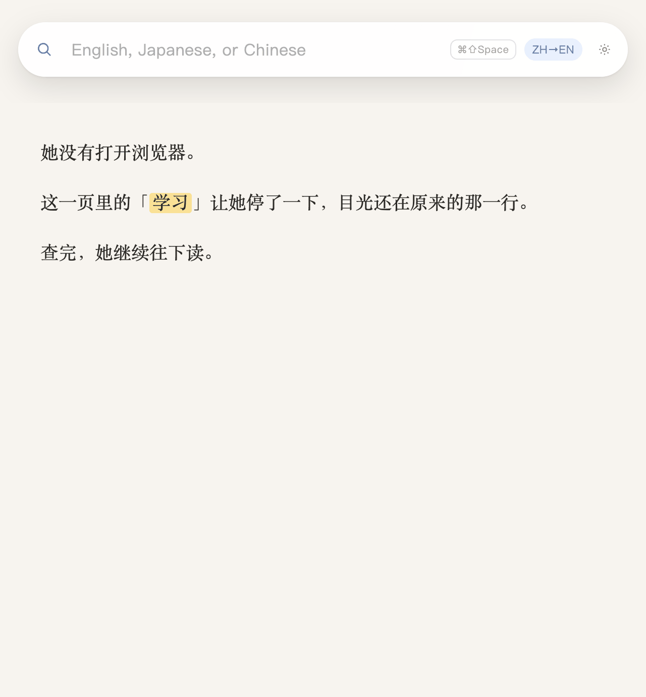
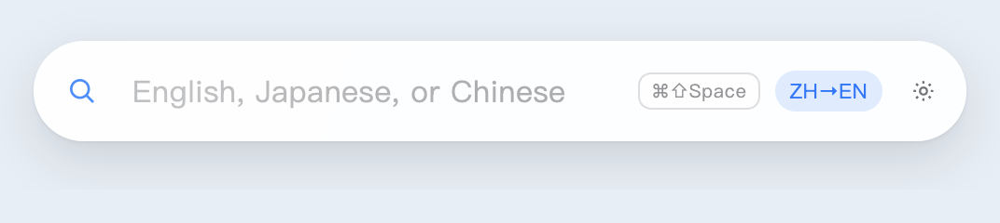
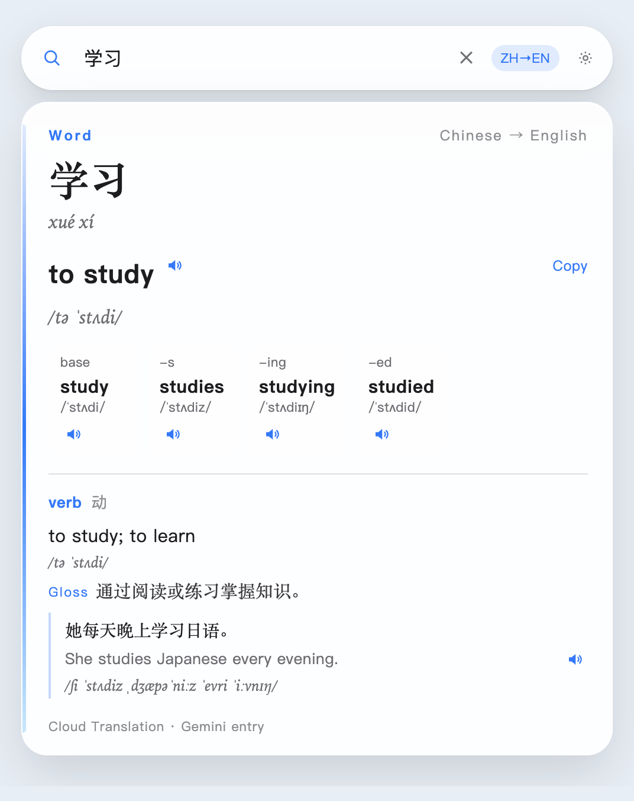
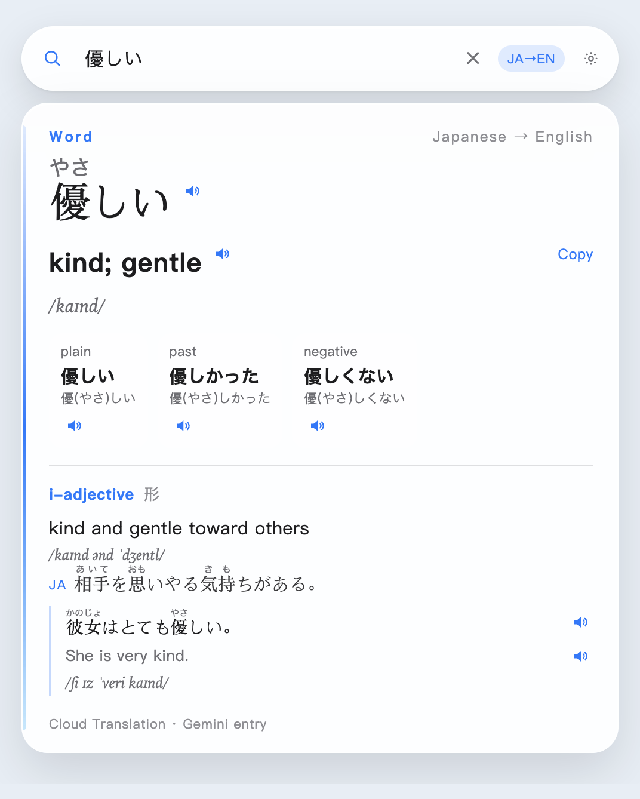
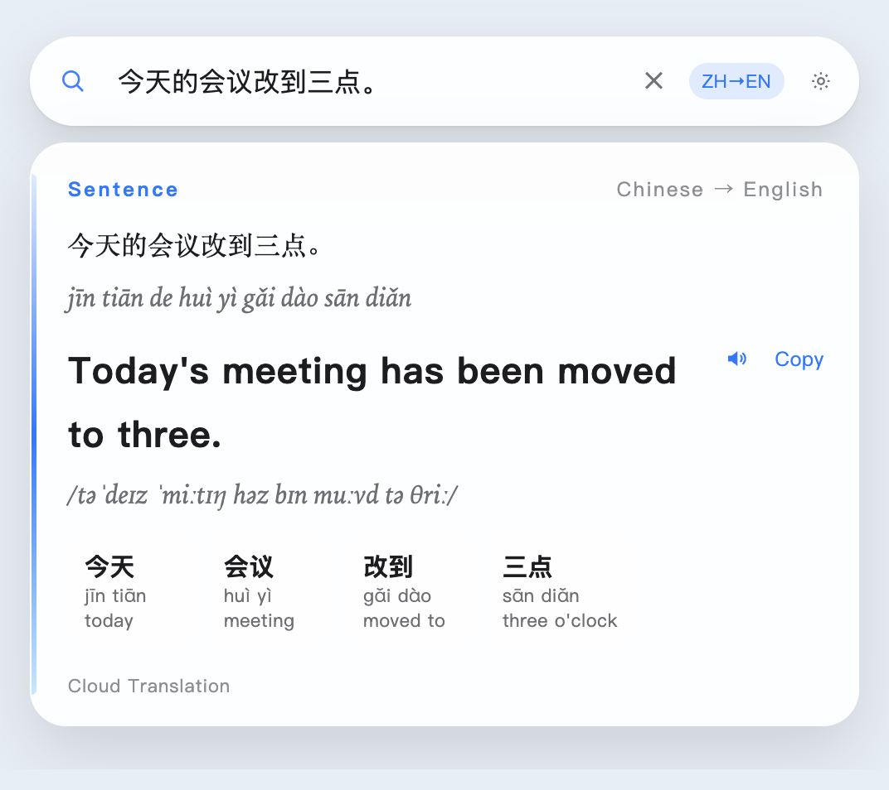
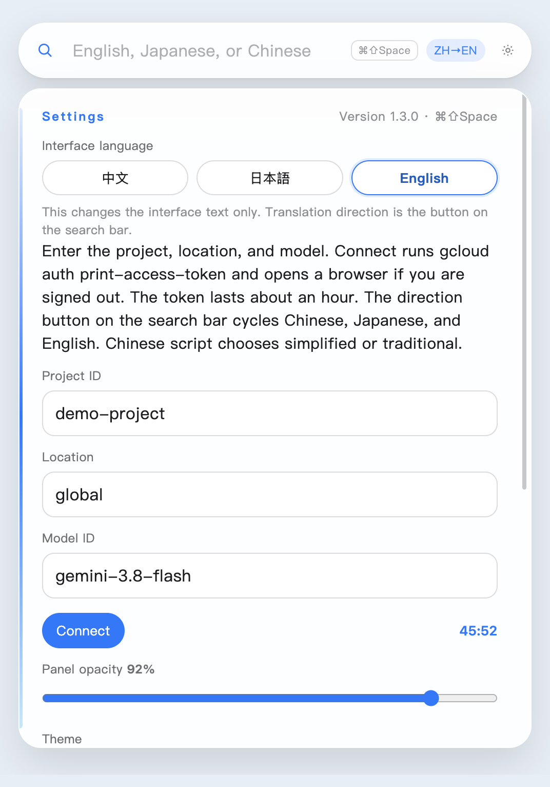
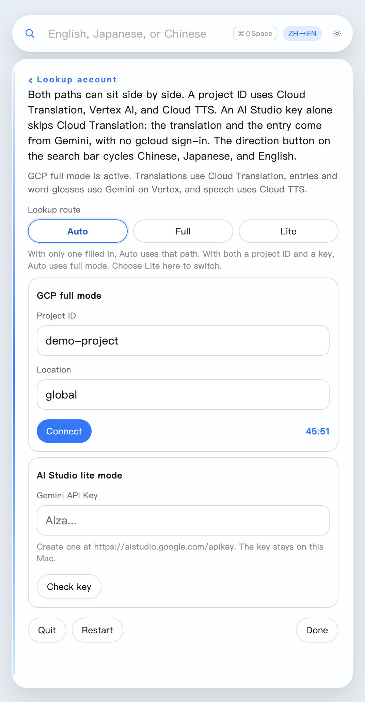
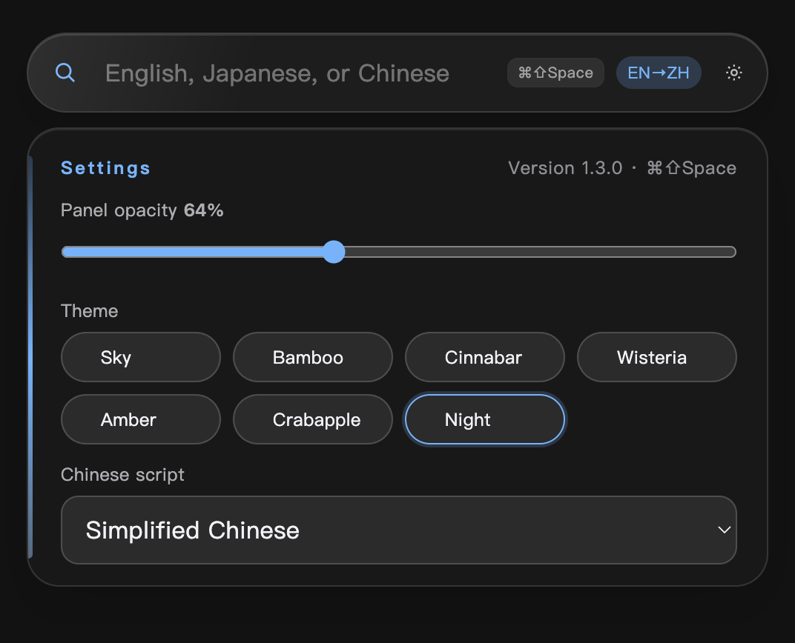

# 浮词 (Fuci)

> **English** — One word should not make you leave the page. **[Quick Start ↓](#step-by-step-setup-guide)** · **[macOS (.dmg)](https://github.com/jayson-sheyue/fuci/releases/download/v1.3.7/fuci-1.3.7-arm64.dmg)** · **[Windows (.zip)](https://github.com/jayson-sheyue/fuci/releases/download/v1.3.7/fuci-1.3.7-win-x64.zip)**
>
> **中文** — 查一个词，不该离开正在读的这一页。**[阅读中文说明 →](README.md)**
>
> **日本語** — 一つの単語のために、読んでいるページを離れたくない。**[日本語で読む →](README.ja.md)**

You are mid-page in an article, paper, or documentation, and one unfamiliar word sends you to a browser tab. By the time you come back, you have lost your line.

**浮词 (Fuci)** is a lightweight, always-on-top floating dictionary and translator for **macOS** and **Windows**. Most of the time it rests as a compact search bar or a tiny translucent orb on your desktop. Press `⌘⇧Space` (`Ctrl+Shift+Space` on Windows) to look up a word or sentence right over the page you are reading, and press `Esc` to fold it away without ever losing your place.



---

## Why 浮词?

- **Smart Word vs. Sentence Split**
  - **Look up a word**: Opens into a structured dictionary card with translation, pronunciation (IPA / kana / pinyin), **word inflections & conjugations** (comparatives, verb tenses, Japanese verb forms), part of speech, bilingual + same-language glosses, example sentences, and audio pronunciation.
  - **Look up a sentence**: Stays a clean sentence card — full translation, a full-sentence pronunciation line, and **word-by-word glosses** for every key token instead of a cluttered dictionary dump.
- **Three-Way Translation (Chinese ↔ Japanese ↔ English)**
  - Cycle effortlessly through `EN→ZH`, `EN→JA`, `JA→ZH`, `JA→EN`, `ZH→EN`, and `ZH→JA`. Interface language (`English` / `中文` / `日本語`) is completely independent from your translation direction, and Chinese output supports both **Simplified** and **Traditional** scripts.
- **Two Flexible Setup Modes (1-Minute AI Studio Key or Full GCP)**
  - **AI Studio Lite Mode (Recommended for most users — 1-minute setup)**: Paste a free `Gemini API Key` from [Google AI Studio](https://aistudio.google.com/apikey). **No GCP project, no billing setup, no `gcloud` CLI, and no hourly sign-in expiration.**
  - **GCP Full Mode (For Google Cloud users)**: Combines `Cloud Translation API` (instant translations), `Vertex AI Gemini` (dictionary entries & token glosses), and `Cloud Text-to-Speech` (natural audio pronunciation). Both credentials can stay saved side by side in Settings with a one-click route switch (`Auto / Full / Lite`).
- **Instant Local Cache & Local-First Privacy**
  - Completed word and sentence lookups are cached locally on your Mac (up to ~400 recent entries). When the same word appears again on the page, it opens instantly without waiting on the network. Your project ID, API key, tokens, and cache **never leave your Mac**.

---

## What It Does at a Glance

Most of the time it is only a slim floating search bar, so it never covers what you are reading.



A **Chinese word** opens into a rich English card: translation, pinyin + IPA pronunciation, word forms (`study / studies / studying / studied`), part of speech, a same-language gloss, a bilingual example sentence, and speaker buttons.



A **Japanese word** does the same with furigana ruby annotations above kanji and direction set to `JA→EN`.



A **sentence** stays a sentence: you get the full English translation, a full pronunciation line, and a word-by-word breakdown for every token.



Double-click the magnifying glass on the left to collapse 浮词 into a floating orb. Double-click the orb to expand it again.


**Settings** is organized into clean, compact pages. Switch the interface language (`中文` / `日本語` / `English`) at the very top, or open **Lookup account**, **Models**, and **Appearance**.



Inside **Lookup account**, **GCP full mode** and **AI Studio lite mode** sit side by side. Keep both saved and switch between `Auto`, `Full`, and `Lite` at any time.



**Appearance** offers seven traditional themes — **Sky, Bamboo, Cinnabar, Wisteria, Amber, Crabapple, and Night** — plus a live opacity slider (40%–100%, default 88%) that adjusts both the search bar and the result card together. Below is **Night** at 64% opacity:



---

## Step-by-Step Setup Guide

### Step 1: Download & Install

Download the latest release for your platform from the [GitHub Releases page](https://github.com/jayson-sheyue/fuci/releases/tag/v1.3.7):

#### 🍎 macOS (Apple Silicon M1 / M2 / M3 / M4, `arm64`)
1. **[Download fuci-1.3.7-arm64.dmg](https://github.com/jayson-sheyue/fuci/releases/download/v1.3.7/fuci-1.3.7-arm64.dmg)**
2. Open the downloaded `.dmg` file and drag **浮词** into your **Applications** folder.
3. **First Launch on macOS (Bypassing the Unnotarized App Prompt)**:
   Because this open-source app is not notarized by Apple, macOS may show a `“浮词” Not Opened` dialog on first launch. Click **Done** (do **not** click *Move to Trash*), then use either method below:
   - **Method A (Fastest — Terminal command)**: Open **Terminal** and run:
     ```bash
     xattr -dr com.apple.quarantine /Applications/浮词.app
     open /Applications/浮词.app
     ```
   - **Method B (System Settings)**: After clicking **Done**, open **System Settings → Privacy & Security**, scroll down to the **Security** section, and click **Open Anyway**.

#### 🪟 Windows (Windows 10 / 11 64-bit, `x64` Portable)
1. **[Download fuci-1.3.7-win-x64.zip](https://github.com/jayson-sheyue/fuci/releases/download/v1.3.7/fuci-1.3.7-win-x64.zip)**
2. Extract the `.zip` archive to any folder (e.g. `D:\Apps\Fuci-win32-x64`).
3. Double-click **`Fuci.exe`** to launch (if Windows SmartScreen prompts, click **More info → Run anyway**; pairing with **AI Studio Lite Mode** below gives an instant zero-dependency setup).

---

### Step 2: Configure Your Lookup Account (Choose Path 1 or Path 2)

This repository does not bundle any pre-configured project ID, account, or API key. You can set up either **AI Studio Lite Mode** or **GCP Full Mode** (or save both and switch anytime):

| Feature | Path 1: AI Studio Lite Mode (Recommended) | Path 2: GCP Full Mode (Full Experience) |
| :--- | :--- | :--- |
| **Setup Time** | **~1 minute** | ~5 minutes |
| **Prerequisites** | Any standard Google account | A Google Cloud project with Billing enabled |
| **Authentication** | Paste a `Gemini API Key` once (**never expires hourly**) | Click **Connect** for browser OAuth (~**1-hour** token, click to renew) |
| **Word & Sentence Lookups** | Full support (Translations, entries & token glosses via Gemini) | Full support (Translations via Cloud Translation + entries via Vertex AI Gemini) |
| **Audio Pronunciation (Speaker)** | Not included | Supported (via Cloud Text-to-Speech) |

#### Path 1: 1-Minute Quick Start — AI Studio Lite Mode (No GCP Project Needed)

If you want to start looking up words immediately without creating a Google Cloud project or setting up billing:

1. Open **[Google AI Studio — API Keys](https://aistudio.google.com/apikey)** in your browser and sign in with your Google account.
2. Click **Create API key** and copy the generated key (starts with `AIza...`).
3. In **浮词**, click the **gear icon `⚙`** on the right side of the search bar → click **Lookup account** (`查词账号`).
4. Scroll to **AI Studio lite mode** and paste your key into the **Gemini API Key** field:
   - If the GCP **Project ID** field above is blank, leave **Lookup route** on **Auto**.
   - If you also have a Project ID saved, switch **Lookup route** to **Lite**.
5. Click **Check key** to verify that your key works, then click **Done**. You are ready to look up words and sentences!

#### Path 2: Full Experience — GCP Full Mode (Cloud Translation + Vertex AI + Audio TTS)

If you have a Google Cloud project and want instant Cloud Translation plus audio pronunciation on the speaker buttons:

1. **Prepare a Google Cloud Project**
   Open the [Google Cloud Console](https://console.cloud.google.com/), create or select a project, make sure **Billing is enabled**, and copy your **Project ID** (e.g. `my-lookup-project`, not the project name or project number).
2. **Enable the 3 Required APIs**
   Enable the following APIs in your project via the Cloud Console search bar:
   - **Cloud Translation API** — used for fast word and sentence translations (if not enabled yet, sentences fall back to Gemini automatically until enabled).
   - **Vertex AI API** — used for dictionary cards, pronunciations, inflections, and examples (default model `gemini-3.8-flash` in `global`).
   - **Cloud Text-to-Speech API** — used only when clicking the speaker button for audio playback (optional for text lookups).
   > **One-Line CLI Shortcut (Optional)**: If you already have `gcloud` installed, enable all three at once in Terminal:
   > ```bash
   > gcloud services enable translate.googleapis.com aiplatform.googleapis.com texttospeech.googleapis.com --project=YOUR_PROJECT_ID
   > ```
3. **Verify IAM Roles**
   - If you are signing in as the project **Owner**, you already have the required permissions — skip to Step 4.
   - Otherwise, grant your Google account these two roles in [IAM & Admin](https://console.cloud.google.com/iam-admin/iam):
     - **Cloud Translation API User** (`roles/cloudtranslate.user`)
     - **Vertex AI User** (`roles/aiplatform.user`)
4. **Connect in 浮词**
   - Open **浮词** → click the gear icon `⚙` → **Lookup account**.
   - Under **GCP full mode**, enter your **Project ID** and keep **Location** set to `global`.
   - Click the blue **Connect** button:
     - If your Mac does not already have a working `gcloud` with a supported Python version, 浮词 automatically downloads a local sign-in component (~80 MB, once only).
     - Your browser will open for Google OAuth sign-in and issue an access token valid for about **1 hour**.
     - A live countdown timer appears next to the button (e.g. `45:51`). When it expires, simply click **Connect** again.

---

### Step 3: Daily Shortcuts & Controls

| Action | Shortcut / Gesture |
| :--- | :--- |
| **Show / Focus Search Bar** | Press `⌘⇧Space` / `Ctrl+Shift+Space` on Windows (falls back to `⌘⇧D` / `Ctrl+Shift+D` if taken) |
| **Run Lookup** | Type a word or sentence and press `Enter` |
| **Cycle Translation Direction** | Click the direction pill on the search bar (`EN→ZH` → `EN→JA` → `JA→ZH` → `JA→EN` → `ZH→EN` → `ZH→JA`) |
| **Close Card / Collapse to Orb** | Press `Esc` once to close the result card; press `Esc` again (or double-click the magnifying glass) to collapse into the orb |
| **Expand from Orb** | Double-click the floating orb, or press `⌘⇧Space` |
| **Move on Screen** | Drag from the magnifying glass on the left of the search bar, or drag the floating orb |
| **Switch Simplified / Traditional Chinese** | Open **Settings → Appearance → Chinese script** (`Simplified` / `Traditional`); the current lookup refreshes automatically |
| **Customize Lookup & Speech Models** | Open **Settings → Models** to change the lookup model (default `gemini-3.8-flash`) or speech model (default `gemini-3.1-flash-tts-preview`) |
| **One-Click In-App Update** | A **red dot** on the gear or orb means a newer version is available on GitHub `main`. Open **Settings** and click **Update** — your settings, sign-in, and cache stay intact |

---

## Run & Pack from Source (For Developers)

```bash
# Install dependencies
npm install

# Run in development mode
npm start

# Build macOS app & DMG installer (updates Desktop/浮词.app, dist/浮词.app, and writes dist/*.dmg)
npm run pack

# Build Windows 64-bit portable archive (writes dist/*-win-x64.zip)
npm run pack:win
```

> **Troubleshooting Electron Install**: If `npm install` or `npm start` reports that Electron failed to install (often caused by corporate SSL proxies blocking Node downloads), use system `curl` to download `electron-v<version>-darwin-arm64.zip`, unzip it into `node_modules/electron/dist`, and write `Electron.app/Contents/MacOS/Electron` into `node_modules/electron/path.txt`.
