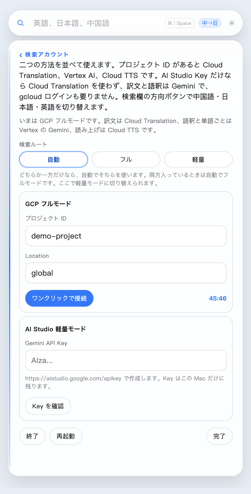

# 浮词 (Fuci)

> **日本語** — 一つの単語のために、読んでいるページを離れたくない。**[クイックスタート ↓](#ステップバイステップ導入ガイド)** · **[macOS (.dmg)](https://github.com/jayson-sheyue/fuci/releases/download/v1.3.7/fuci-1.3.7-arm64.dmg)** · **[Windows (.zip)](https://github.com/jayson-sheyue/fuci/releases/download/v1.3.7/fuci-1.3.7-win-x64.zip)**
>
> **中文** — 查一个词，不该离开正在读的这一页。**[阅读中文说明 →](README.md)**
>
> **English** — One word should not make you leave the page. **[Read in English →](README.en.md)**

論文や技術ドキュメント、Web 記事を読んでいる途中で分からない単語に出会い、ブラウザの別タブや辞書アプリへ切り替えると、戻ったときには元の行を見失ってしまいます。

**浮词（Fuci）** は、**macOS** と **Windows** のデスクトップ最前面に常駐する軽量なフローティング辞書・翻訳ツールです。普段は小さな検索バーまたは半透明の球（オーブ）として控えめに待機し、`⌘⇧Space`（Windows は `Ctrl+Shift+Space`）でその場に呼び出して調べ、`Esc` で閉じることができます。視線は常に読んでいるページの上から離れません。


---

## 浮词の特長

- **単語と文を自動判別し、それぞれに最適なレイアウトで表示**
  - **単語を引く**：構造化された辞書カードが開きます。訳語、読み（発音記号・ふりがな・ピンイン）、**語形変化・活用形（比較級、動詞の時制、日本語の辞書形／ます形／て形）**、品詞、二言語＋母語での語釈、例文、音声読み上げを備えています。
  - **文を引く**：単語カードにはせず、**全文の訳、全文の読み、そして重要な語ごとの短い意味（逐語解説）**だけをすっきり表示します。
- **中国語・日本語・英語の相互翻訳（表示言語と翻訳方向は独立）**
  - `英→中`、`英→日`、`日→中`、`日→英`、`中→英`、`中→日` の 6 方向をワンクリックで切り替え可能。日本語の漢字には自動でふりがな（ルビ）が振られ、中国語は**簡体字／繁体字**をいつでも切り替えられます。
- **選べる 2 つの接続モード（1 分で使える AI Studio Key ／ フル機能の GCP）**
  - **AI Studio 軽量モード（初心者におすすめ・1 分で導入完了）**：[Google AI Studio](https://aistudio.google.com/apikey) で無料発行できる `Gemini API Key` を貼り付けるだけ。**GCP プロジェクトの作成も、請求設定（クレジットカード登録）も、`gcloud` の導入も、1 時間ごとの再ログインも不要です。**
  - **GCP フルモード（Google Cloud 利用者向け）**：`Cloud Translation API`（高速翻訳）、`Vertex AI Gemini`（詳細な辞書カード・逐語解説）、`Cloud Text-to-Speech`（自然な音声読み上げ）を組み合わせて動作します。両方の認証情報を設定に並べて保存し、「検索ルート（自動／フル／軽量）」でいつでも切り替えられます。
- **高速なローカルキャッシュと安心のプライバシー**
  - 引き終わった単語や文はこの Mac に最大約 400 件キャッシュされます。同じページで再び出てきた単語はネットワーク待ちなしで即座に開きます。プロジェクト ID、API Key、トークン、検索キャッシュは**すべてお使いの Mac 内にのみ保存されます**。

---

## 画面で見る機能紹介

普段は細い検索欄だけなので、読んでいる内容を隠しません。


**中国語の単語**を引くとカードが開きます。日本語訳（ルビ付き）、ピンイン、活用形（`勉強する / 勉強します / 勉強して`）、品詞、語義、例文、そしてスピーカーの読み上げボタンが並びます。


**英語の単語**も同じです。方向ボタンを「英→日」にすると、発音記号や活用形とともに日本語の辞書カードが開きます。


**文**は単語カードにはなりません。全文の日本語訳、英語の発音記号、そして語ごとの読みと意味だけが表示されます。


検索欄の左にある虫眼鏡をダブルクリックすると、デスクトップ上の小さな球（フローティングボール）に収まります。球をもう一度ダブルクリックすると元の検索欄に戻ります。


**設定画面**はすっきり整理されています。一番上で表示言語（`中文` / `日本語` / `English`）を即座に切り替えられ、その下に**「検索アカウント」「モデル」「外観」**の 3 つのページが並んでいます。


**「検索アカウント」**ページでは、`GCP フルモード` と `AI Studio 軽量モード` の両方を保存でき、上部の**「検索ルート（自動 / フル / 軽量）」**でいつでも手動切り替えが可能です。



**「外観」**ページには 7 つのテーマ（**青空、青竹、朱、藤、琥珀、海棠、夜**）と、検索欄・カードの両方に効く「パネルの不透明度」スライダー（40%〜100%、初期値 88%）があります。下は「夜」テーマ・不透明度 64% の表示例です：


---

## ステップバイステップ導入ガイド

### ステップ 1：ダウンロードとインストール

[GitHub Releases ページ](https://github.com/jayson-sheyue/fuci/releases/tag/v1.3.7) からお使いの OS 向けパッケージをダウンロードします：

#### 🍎 macOS（Apple シリコン M1 / M2 / M3 / M4、`arm64`）
1. **[fuci-1.3.7-arm64.dmg をダウンロード](https://github.com/jayson-sheyue/fuci/releases/download/v1.3.7/fuci-1.3.7-arm64.dmg)**
2. ダウンロードした `.dmg` を開き、**「浮词」** を **「アプリケーション（Applications）」** フォルダへドラッグします。
3. **初回起動時の注意（macOS の未公証アプリの開き方）**：
   ブラウザからダウンロードしたアプリは Apple の公証（Notarization）を受けていないため、初回起動時に `“浮词” Not Opened（“浮词”は開かれませんでした）` と表示されることがあります。その場合は **Done（完了）** を押し（*Move to Trash / ゴミ箱に入れる* は押さないでください）、次のいずれかの方法で開いてください：
   - **方法 A（推奨・ターミナルで 2 行実行）**：「ターミナル（Terminal）」を開き、次のコマンドを貼り付けて実行します：
     ```bash
     xattr -dr com.apple.quarantine /Applications/浮词.app
     open /Applications/浮词.app
     ```
   - **方法 B（システム設定から開く）**：Done を押したあと、Mac の「システム設定 → プライバシーとセキュリティ」を開き、下部の「セキュリティ」欄にある **「このまま開く（Open Anyway）」** をクリックします。

#### 🪟 Windows（Windows 10 / 11 64 ビット、`x64` ポータブル版）
1. **[fuci-1.3.7-win-x64.zip をダウンロード](https://github.com/jayson-sheyue/fuci/releases/download/v1.3.7/fuci-1.3.7-win-x64.zip)**
2. `.zip` を任意のフォルダへ展開します。
3. フォルダ内の **`Fuci.exe`** をダブルクリックして起動します（Windows SmartScreen の確認が出た場合は「詳細情報 → 実行」をクリックしてください。下の **AI Studio 軽量モード** と組み合わせると 1 分ですぐ使い始められます）。

---

### ステップ 2：検索アカウントの設定（2 つの方法から選択）

このリポジトリにはプロジェクト ID やアカウント、API キーは含まれていません。用途に合わせて **AI Studio 軽量モード** または **GCP フルモード** のどちらかを設定してください（両方入力して切り替えることも可能です）：

| 比較項目 | 方法 1：AI Studio 軽量モード（初心者におすすめ） | 方法 2：GCP フルモード（フル機能） |
| :--- | :--- | :--- |
| **所要時間** | **約 1 分** | 約 5 分 |
| **必要なもの** | 通常の Google アカウントのみ | 請求（Billing）が有効な Google Cloud プロジェクト |
| **ログイン方法** | `Gemini API Key` を一度貼るだけ（**1 時間ごとの期限切れなし**） | 「ワンクリックで接続」でブラウザ認証（トークン有効期限は**約 1 時間**） |
| **単語・文の検索** | すべて対応（訳文・語釈・逐語解説をすべて Gemini で生成） | すべて対応（Cloud Translation で高速翻訳 ＋ Vertex AI Gemini で語釈生成） |
| **音声読み上げ（スピーカー）** | 非対応 | 対応（Cloud Text-to-Speech を使用） |

#### 方法 1：1 分で完了 —— AI Studio 軽量モード（GCP プロジェクト不要）

Google Cloud のプロジェクト作成や請求設定を行わずに、すぐ使い始めたい場合はこちらが最も簡単です：

1. ブラウザで **[Google AI Studio — API Keys](https://aistudio.google.com/apikey)** を開き、Google アカウントでログインします。
2. **「Create API key」** をクリックし、発行された `AIza...` で始まるキーをコピーします。
3. **浮词** を開き、検索欄右端の **歯車アイコン `⚙`（設定）** → **「検索アカウント」** を開きます。
4. 下部の **「AI Studio 軽量モード」** にある **「Gemini API Key」** 欄へコピーしたキーを貼り付けます：
   - 上の GCP「プロジェクト ID」が空欄なら、検索ルートは **「自動」** のままで構いません。
   - プロジェクト ID も入力してある場合は、検索ルートを **「軽量」** に切り替えます。
5. **「Key を確認」** を押して接続を確認し、右下の **「完了」** を押せば準備完了です！

#### 方法 2：フル機能 —— GCP フルモード（高速翻訳 ＋ 音声読み上げ対応）

すでに Google Cloud プロジェクトをお持ちの方や、スピーカーボタンでの音声読み上げを使いたい場合はこちらを設定します：

1. **Google Cloud プロジェクトの準備**
   [Google Cloud Console](https://console.cloud.google.com/) を開き、請求（Billing）が有効なプロジェクトを用意して **プロジェクト ID（Project ID）**（例：`my-project-123`）を控えます。
2. **3 つの API を有効化**
   そのプロジェクトで次の API を有効にします：
   - **Cloud Translation API**：単語と文の翻訳に使用します（未有効のときは文もまず Gemini が訳し、有効化すると自動で切り替わります）。
   - **Vertex AI API**：語釈、読み、活用形、例文の生成に使用します（既定モデル `gemini-3.8-flash`、リージョン `global`）。
   - **Cloud Text-to-Speech API**：スピーカーボタンでの音声読み上げにのみ使用します（無効でも検索は可能です）。
   > **コマンド 1 行で有効化（任意）**：Mac に `gcloud` が入っている場合は、ターミナルで次の 1 行を実行するだけで 3 つまとめて有効化できます：
   > ```bash
   > gcloud services enable translate.googleapis.com aiplatform.googleapis.com texttospeech.googleapis.com --project=あなたのプロジェクトID
   > ```
3. **アカウントの IAM ロールを確認**
   - プロジェクトの作成者（`Owner`）アカウントでログインする場合はそのままステップ 4 へ進めます。
   - 別のアカウントを使う場合は、[IAM 画面](https://console.cloud.google.com/iam-admin/iam) でログイン用 Google アカウントに次のロールを付与してください（`Cloud Translation API User` が無い場合も、全文翻訳は自動で Gemini にフォールバックします）：
     - **Agent Platform User**（旧 **Vertex AI User**、`roles/aiplatform.user`）
     - **Cloud Translation API User**（`roles/cloudtranslate.user`、推奨）
4. **浮词で「ワンクリックで接続」**
   - **浮词** の歯車アイコン `⚙` → **「検索アカウント」** を開きます。
   - **「GCP フルモード」** に **プロジェクト ID** を入力し、`Location` は `global` のままにします。
   - 青い **「ワンクリックで接続」** ボタンを押します：
     - この PC / Mac に使える `gcloud` がまだ無い場合、初回のみログイン部品（約 80MB）を自動でダウンロードします。
     - ブラウザが開いて Google アカウントのログインが行われ、約 **1 時間**有効なアクセストークンを取得します。
     - ボタンの右に残り時間（例：`45:46`）が表示されます。期限が切れたら、もう一度「ワンクリックで接続」を押してください。

---

### ステップ 3：基本操作とショートカット一覧

| 操作 | ショートカット / 操作方法 |
| :--- | :--- |
| **検索欄を呼び出す** | `⌘⇧Space` / Windows は `Ctrl+Shift+Space`（競合時は自動で `⌘⇧D` / `Ctrl+Shift+D`） |
| **単語・文を引く** | 語句や文を入力して `Enter` |
| **翻訳方向の切り替え** | 検索欄の方向ボタンを押すたびに `英→中`、`英→日`、`日→中`、`日→英`、`中→英`、`中→日` と順送り |
| **カードを閉じる / 球にする** | `Esc` を 1 回押すと結果カードを閉じ、もう一度 `Esc`（または左の虫眼鏡をダブルクリック）で小さな球になります |
| **球から検索欄に戻す** | 球をダブルクリック、または `⌘⇧Space` |
| **位置の移動** | 検索欄左の虫眼鏡、または球を押さえたままドラッグ |
| **簡体字 / 繁体字の切り替え** | 「設定 → 外観 → 中国語の表記」で切り替え（現在の検索結果も新しい表記で自動的に引き直します） |
| **検索 / 読み上げモデルの変更** | 「設定 → モデル」で検索モデル（既定 `gemini-3.8-flash`）や読み上げモデル（既定 `gemini-3.1-flash-tts-preview`）を変更可能 |
| **アプリのワンクリック更新** | 歯車または球に**赤い点**が出たら、GitHub の `main` に新しい版があります。「設定」を開いて **「更新」** を押すと、設定・ログイン・キャッシュを保ったまま最新コードへ更新されます |

---

## ソースからの起動とパッケージ作成（開発者向け）

```bash
# 依存パッケージのインストール
npm install

# 開発モードで起動
npm start

# macOS アプリの再パッケージ（デスクトップの 浮词.app、dist/浮词.app、dist/*.dmg を更新）
npm run pack

# Windows 64 ビット ポータブル版の作成（dist/*-win-x64.zip を生成）
npm run pack:win
```

> **Electron のインストールに失敗する場合**：会社のプロキシ証明書などが Node のダウンロードを止めている場合は、システムの `curl` で `electron-vバージョン-darwin-arm64.zip` を取得して `node_modules/electron/dist` に展開し、`node_modules/electron/path.txt` の内容を `Electron.app/Contents/MacOS/Electron` にしてください。
