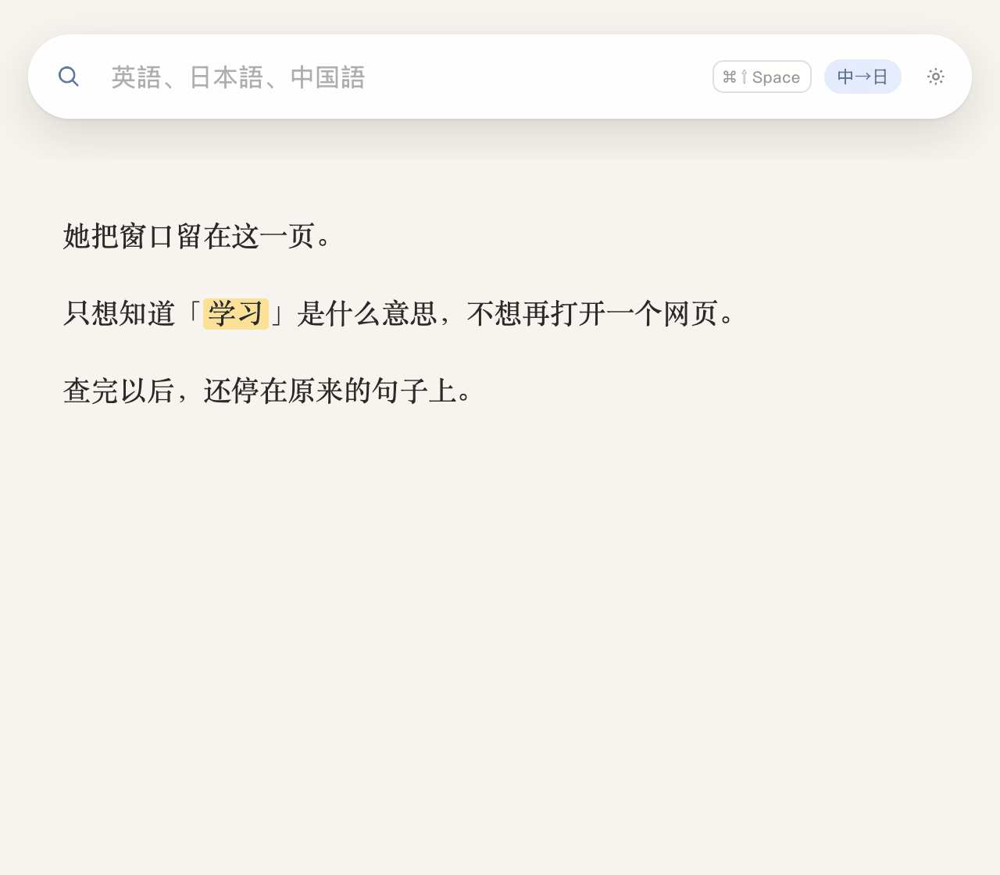
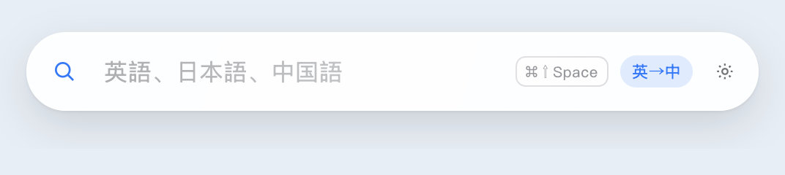
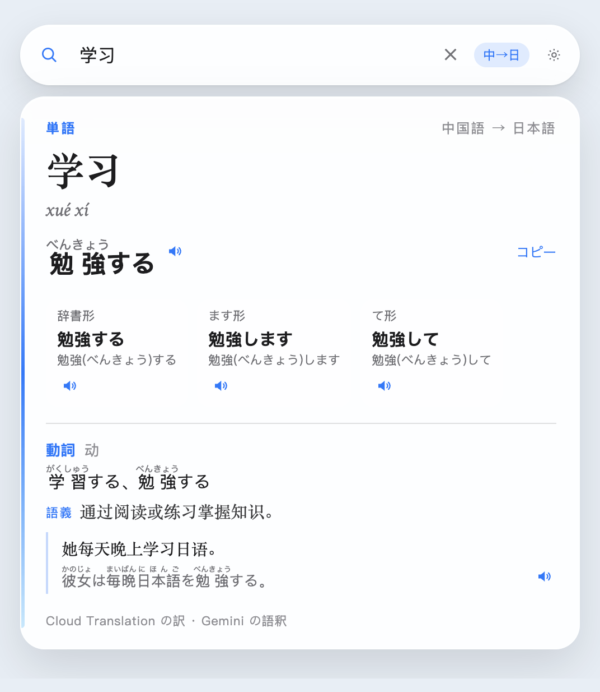
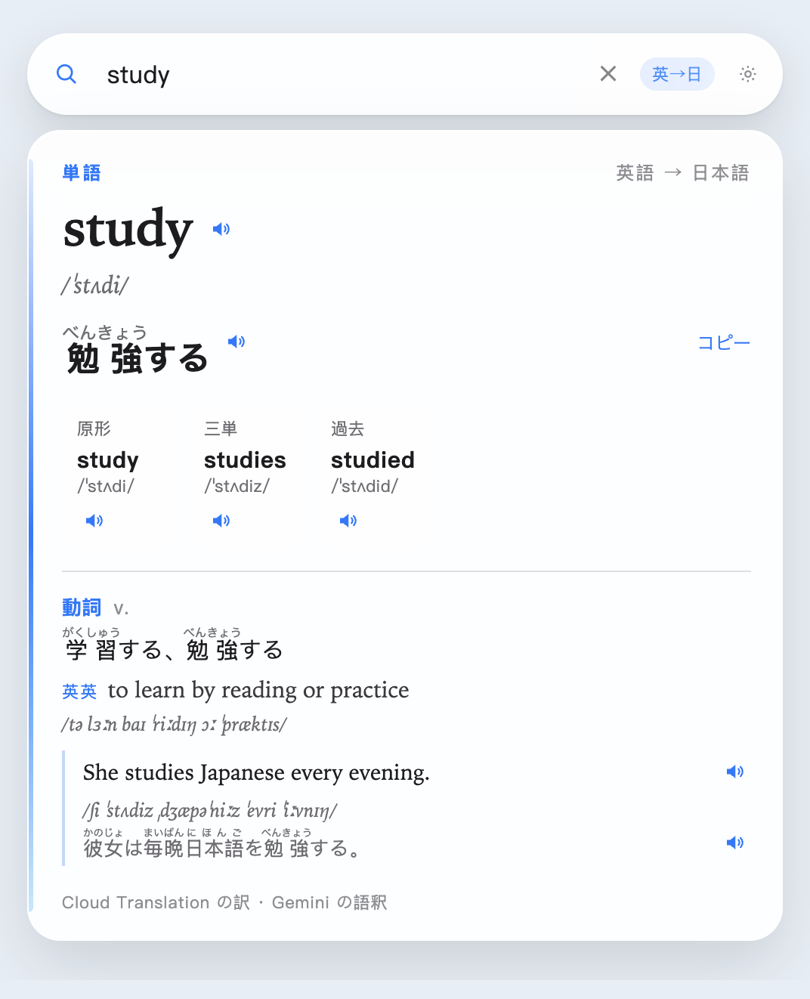
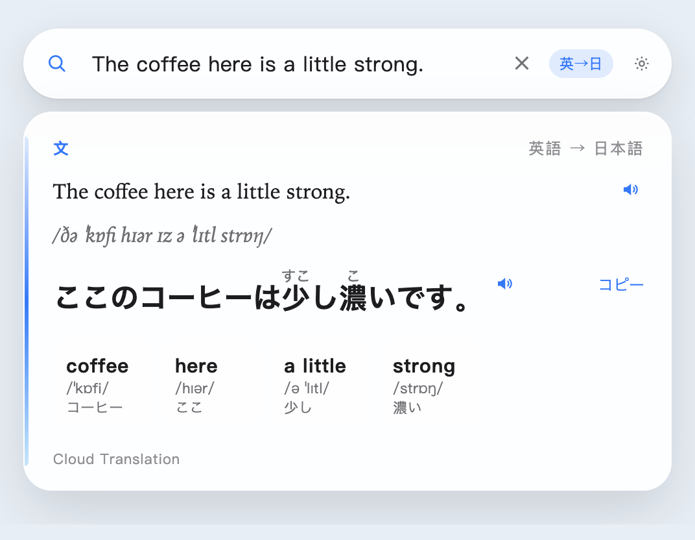
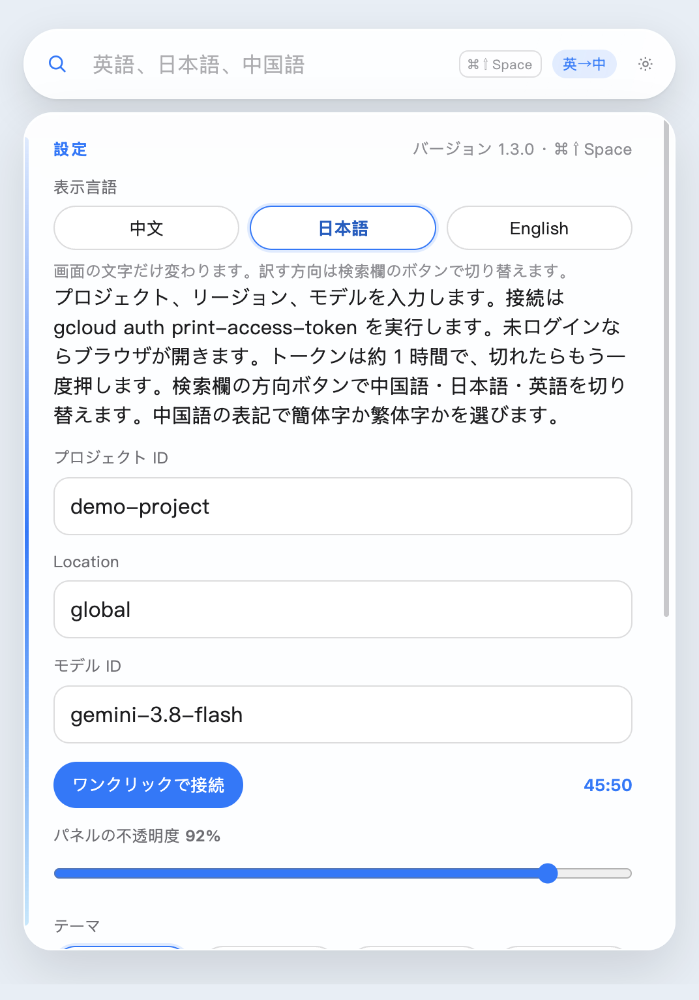
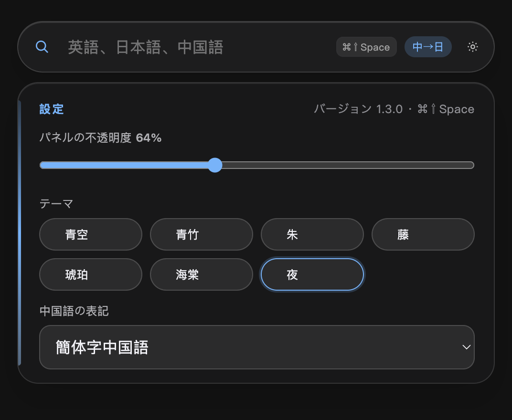

# 浮词

> **日本語** — このページです。一つの単語のために、読んでいるページを離れたくない。
>
> **中文** — 查一个词，不该离开正在读的这一页。**[阅读中文说明 →](README.md)**
>
> **English** — One word should not make you leave the page. **[Read in English →](README.en.md)**

読みかけのページで一つの単語を引くためにブラウザへ移ると、戻ったとき元の行がどこだかわからなくなります。浮词は読んでいる内容の手前に残るので、調べたあとも同じ場所にいます。

よいところは三つです。

- 単語はカードになります。訳、読み、品詞、例文です。文はカードにせず、全文の訳と語ごとの短い意味だけです。
- 中国語、日本語、英語を互いに訳せるので、自分の言語へ訳せます。
- 一度引いた結果はこの Mac に残ります。同じページでもう一度出てきても、待たずに出ます。

その単語はページに残ったままです。入力するとカードが開き、しまっても元の文はそこです。



## 何ができるか

普段は検索欄だけなので、読んでいる内容を隠しません。



中国語の単語はカードになります。訳、発音、品詞、同じ言語での説明、例文、そして読み上げボタンがあります。方向ボタンは「中→日」です。



英語の単語も同じです。方向は「英→日」です。



文は単語カードにはなりません。全文の日本語訳、読み、語ごとの短い意味だけです。



検索欄の左にある虫眼鏡をダブルクリックすると、机の上の小さな球になります。球をもう一度ダブルクリックすると開きます。


設定のいちばん上が表示言語です。「中文」「日本語」「English」を押すと、ボタンとメニューがすぐにその言語になります。訳す方向は検索欄のボタンのままで、表示言語とは別です。



テーマは七つです。青空、青竹、朱、藤、琥珀、海棠、夜。一つ押すと、検索欄、カード、球が一緒に変わります。不透明度のつまみは検索欄とカードの両方に効き、初期値は 88% です。下は「夜」を 64% にしたところです。色の選択肢とつまみは同じページにあります。



## 使う前に

検索は二つの方法から選べ、設定には両方を並べておけます。このリポジトリにプロジェクト ID、アカウント、鍵は入っていません。

- Apple シリコン（arm64）の Mac。
- **AI Studio 軽量モード**：[Google AI Studio](https://aistudio.google.com/apikey) で API Key を作り、設定に貼ります。GCP プロジェクトも gcloud も要りません。訳文、語釈、単語ごとは Gemini です。読み上げはこの方法にはありません。
- **GCP フルモード**：プロジェクト ID を入れるとこちらです。Key も入っていても同じです。さらに必要です：
  - 請求が有効な Google Cloud プロジェクト。
  - そのプロジェクトで有効にする API：
    - **Cloud Translation API**：訳文。文もまずここを使います。
    - **Vertex AI API**：語釈、読み、例文。既定のモデルは `gemini-3.8-flash`、リージョンは `global` です。
    - **Cloud Text-to-Speech API**：スピーカーボタンだけで使います。無効でも検索はできます。
  - ログインする Google アカウントをこのプロジェクトに追加し、次のロールを付けます。
    - **Cloud Translation API User**（`roles/cloudtranslate.user`）
    - **Vertex AI User**（`roles/aiplatform.user`）

インストールパッケージにはウィンドウだけが入っています。最初の「ワンクリックで接続」で、この Mac に使える gcloud がなければ、ログイン部品を約 80MB、一度だけダウンロードします。設定にプロジェクト ID を入れ、「ワンクリックで接続」を押します。アカウント、トークン、検索キャッシュはこの Mac だけに残ります。

## ダウンロード

[リリース](https://github.com/jayson-sheyue/fuci/releases/tag/v1.3.6) からインストールパッケージを落とします。開いて「浮词」を「アプリケーション」にドラッグします。Apple シリコン（arm64）用です。

- [1.3.6](https://github.com/jayson-sheyue/fuci/releases/download/v1.3.6/fuci-1.3.6-arm64.dmg)

ダウンロードしたアプリは Apple の公証を受けていません。最初に「“浮词” Not Opened」と出たら、**Done**（完了）を押し、Move to Trash（ゴミ箱に入れる）は押さないでください。そのあとターミナルで実行します。

```bash
xattr -dr com.apple.quarantine /Applications/浮词.app
open /Applications/浮词.app
```

Done のあと、「システム設定 → プライバシーとセキュリティ」のセキュリティ欄で「このまま開く」を選んでも開けます。

## 起動

デスクトップの「浮词.app」をダブルクリックしても起動できます。このソースで `npm run pack` すると、そのアプリと `dist/浮词.app` が新しいパッケージに置き換わり、`dist/` に上の DMG ができます。

ソースからパッケージを作るには:

```bash
npm install
npm run pack
```

開発中は `npm start` でも動きます。検索欄はすべてのデスクトップの手前に残ります。`⌘⇧Space` で呼び出し、使われていれば `⌘⇧D` になります。虫眼鏡をダブルクリックすると球になり、球をダブルクリックすると開きます。虫眼鏡か球を押さえたままドラッグできます。`Esc` はまずカードを閉じ、もう一度で球になります。方向ボタンの初期値は「英→中」です。押すたびに 英→中、英→日、日→中、日→英、中→英、中→日 と回ります。英語の画面では EN→ZH のように表示されます。

引き終わった単語と文は、この Mac に約 400 件残ります。次に同じものを引くときは、その結果をすぐ使い、翻訳 API と Gemini を待ちません。英語の大文字と小文字は同じ語です。訳す方向、モデル、リージョンが違うときは別に保存します。不完全な結果は残しません。たとえば辞書の取得に失敗したときや、文の読みや語ごとの意味がまだないときです。スピーカーボタンの読み上げは、そのたびに音声 API へ問い合わせます。

設定のタイトル右に、いまのバージョンが出ます。同じページで表示言語を中国語、日本語、英語に切り替え、七つのテーマも選べます。下の「終了」と「再起動」は、先に設定を保存します。歯車か球に赤い点が出たら、GitHub の `main` に早送りできる新しい版があります。設定を開いて「更新」を押します。ソースから動かしている場合は `git pull`、インストールしたアプリはリポジトリの最新プログラムを落として中のコードを入れ替えます。この Mac の設定、ログイン、検索キャッシュはそのままです。まだ push していないローカルのコミットがあるときは、上書きしません。

## GCP につなぐ

リポジトリにプロジェクト ID、アクセストークン、Google アカウントは入っていません。これらはこの Mac だけに保存されます。DMG にはウィンドウだけが入っています。使える gcloud がまだ無い Mac では、最初の接続でログイン部品を約 80MB、一度だけダウンロードします。検索アカウントのページでプロジェクト ID と Location、または AI Studio Key だけを入力します。モデルのページで検索モデルと読み上げモデルを変えられます。「ワンクリックで接続」は `gcloud auth print-access-token` を実行し、約 1 時間のトークンを取ります。未ログインならブラウザが開き、`gcloud auth login` になります。右のカウントが終わるか、期限切れと出たら、もう一度接続します。「外観」ページの「パネルの不透明度」は検索欄と結果を同時に変え、初期値は 88% で、ドラッグした直後に反映されます。「中国語の表記」は、中国語を含む方向を簡体字にするか繁体字にするかを決めます。変えたあと、いまの検索は新しい表記で引き直します。

有効にする API と付与するロールは、上の「使う前に」にまとめてあります。

単語の検索は二つの API を使います。

- **Cloud Translation API**: 検索欄の方向に合わせた訳。文もまずここを使います
- **Vertex AI Gemini**（既定は `gemini-3.8-flash`、リージョンは `global`）: 発音、品詞、意味、例文

Cloud Translation がまだ有効でないときは、文はまず Gemini が訳し、カードの下にその旨が出ます。有効にすると、自動で翻訳 API に切り替わります。語釈はモデルが作るので、まれな読みは確認した方がよいです。

`npm start` で Electron のインストールに失敗するときは、会社の証明書が Node のダウンロードを止めていることが多いです。システムの curl で `electron-vバージョン-darwin-arm64.zip` を落とし、`node_modules/electron/dist` に展開し、`node_modules/electron/path.txt` の内容を `Electron.app/Contents/MacOS/Electron` にしてください。
