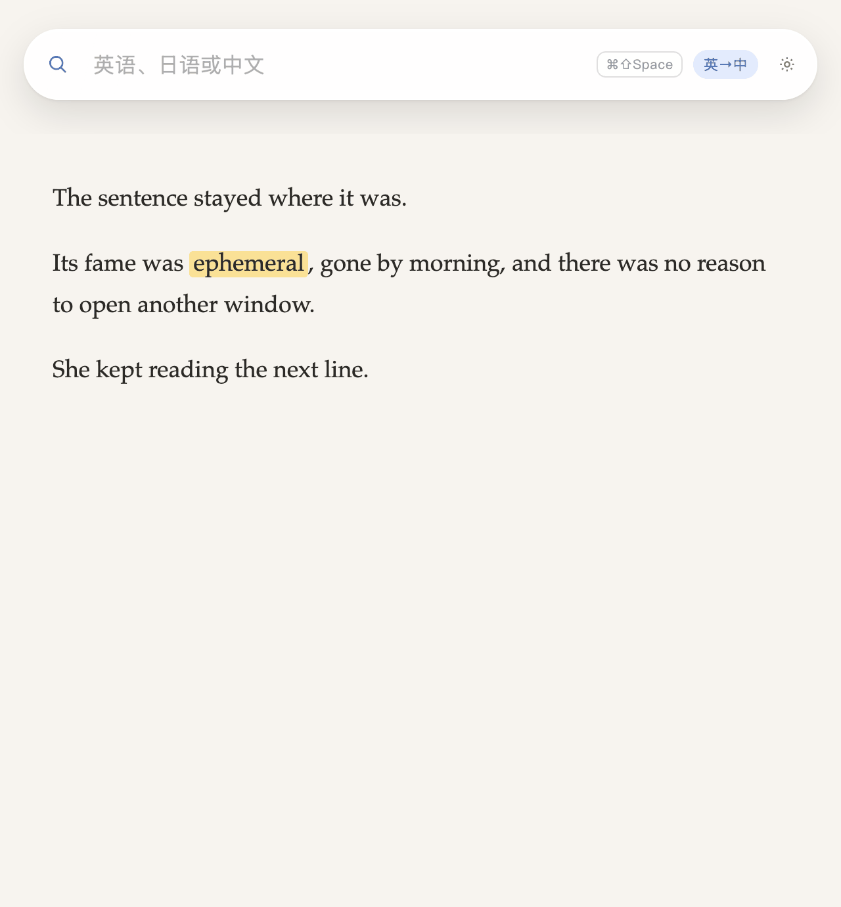
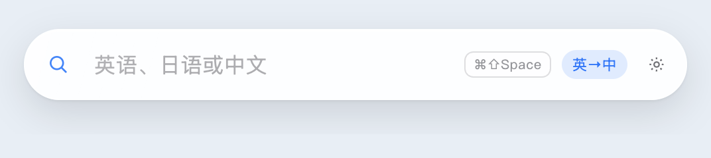
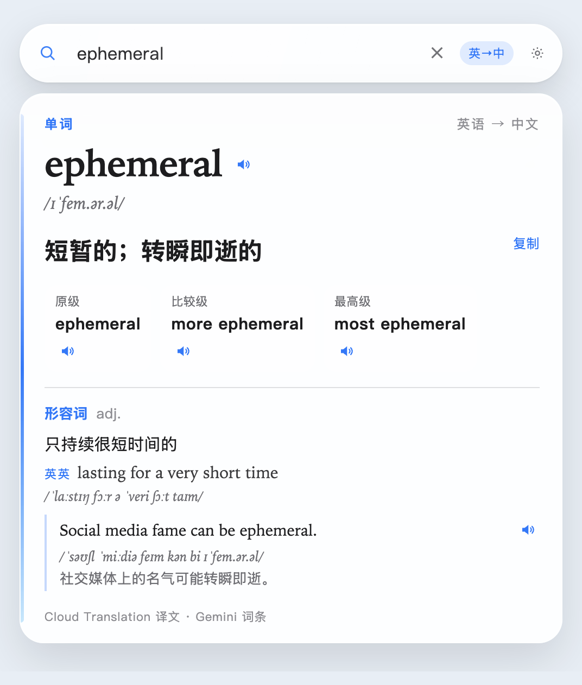
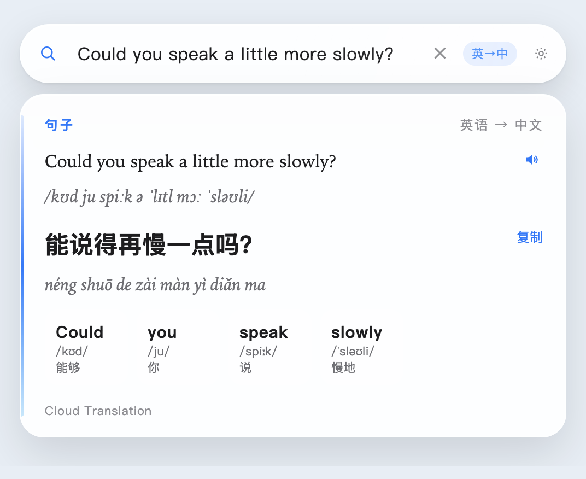
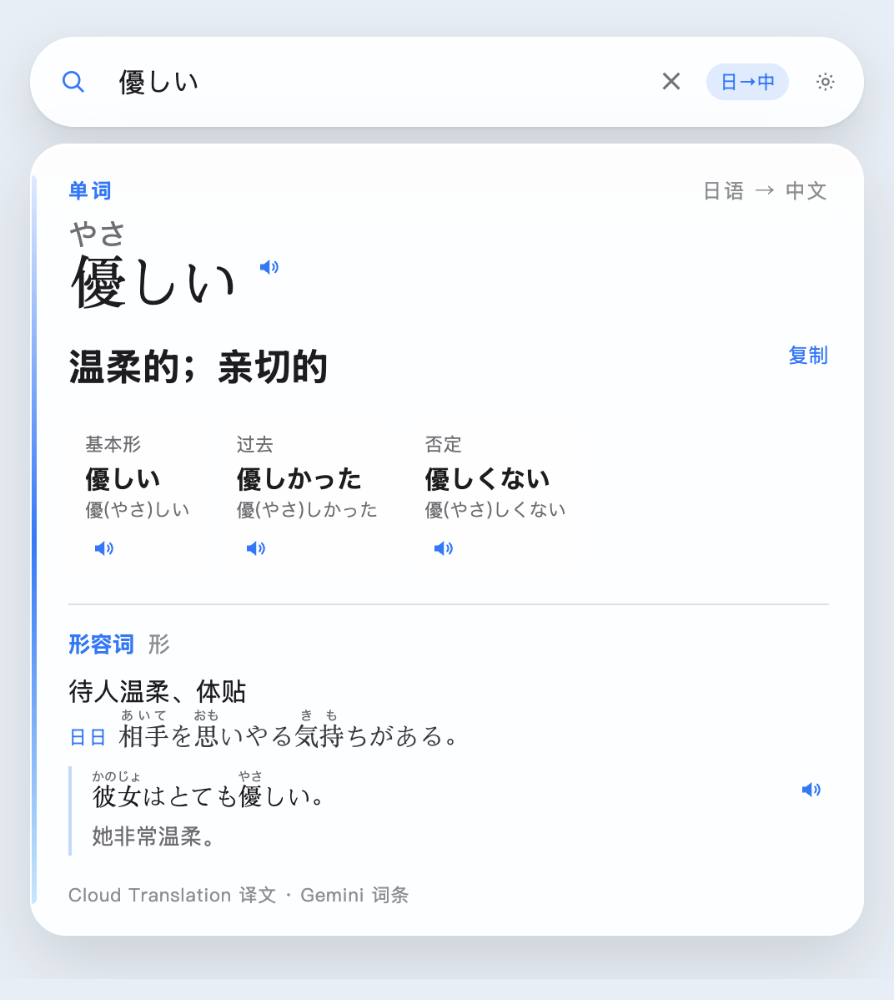
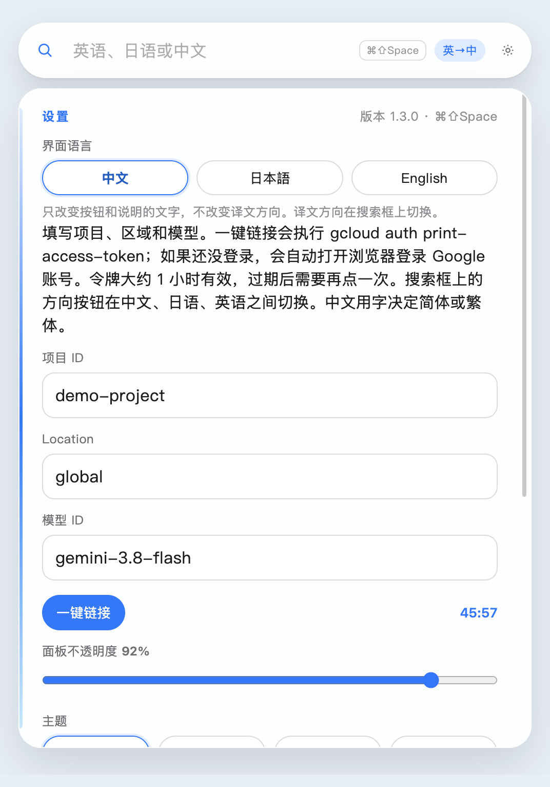
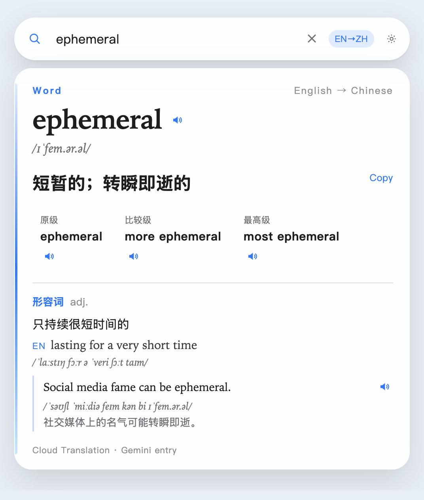
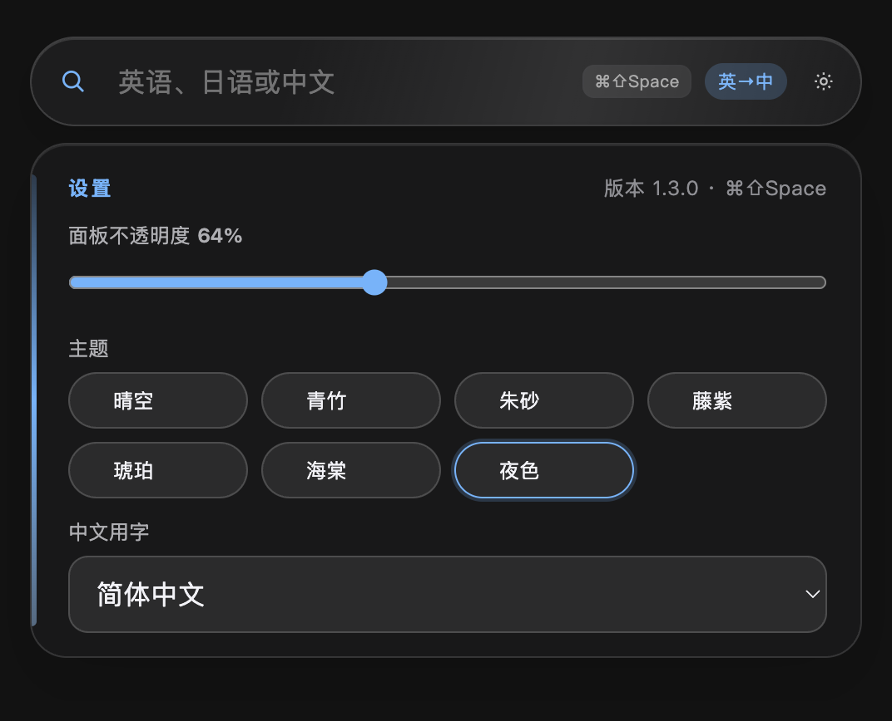

# 浮词

> **English** — One word should not make you leave the page. **[Read in English →](README.en.md)**
>
> **日本語** — 一つの単語のために、読んでいるページを離れたくない。**[日本語で読む →](README.ja.md)**
>
> **中文** — 查一个词，不该离开正在读的这一页。往下就是说明。

读到一半要查一个词，就得切去浏览器，回来时已经找不到刚才那一行。浮词停在正在读的内容上面，查完还在原来的地方。

它好在三件事：

- 一个词展开成卡片：译文、读音、词性、例句。一整句不铺成词条，只给整句译文和逐词意思。
- 中文、日语、英语可以互相翻译，译进的是你自己的语言。
- 查过的词留在这台 Mac 上。同一页里再遇到，不用再等。

读到这个词，搜索条还在这一页上。打出来，卡片盖住原文；收成小球，原文还在。



## 看一眼就知道它做什么

平时只有一条搜索框，挡不住正在读的内容。



单词会展开成一张卡片：译文、音标、词性、英英释义、例句，还能点喇叭听读音。



句子不铺成词条，只留整句译文、拼音或音标，以及逐词释义。



日语词也一样。方向按钮切到「日→中」，卡片上就是假名和中文译文。



双击搜索框左侧的放大镜，它会收成一颗小球，停在桌面上。双击小球再展开。


设置页最上面就是界面语言。点「中文」「日本語」或「English」，按钮和菜单立刻换成那种语言。



换成英语之后，卡片上的「单词」「复制」会变成 Word、Copy。译文本身仍按你设的方向显示，所以英文界面下也可以继续把英语译成中文。



主题有七种：晴空、青竹、朱砂、藤紫、琥珀、海棠、夜色。点一下，搜索条、白板和悬浮球一起换。不透明度拉杆同时作用于搜索框和结果板，默认 88%。下面是夜色、64% 的样子，主题色块和拉杆都在这一页。



## 使用前需要

查词要连你自己的 GCP 项目。仓库里没有项目 ID、账号或密钥。

- 一台 Apple 芯片（arm64）的 Mac。
- 一个已开通结算的 Google Cloud 项目。
- 在这个项目里启用：
  - **Cloud Translation API**：译文。句子也优先走这里。
  - **Vertex AI API**：词条、读音和例句。默认模型 `gemini-3.8-flash`，区域 `global`。
  - **Cloud Text-to-Speech API**：只有点喇叭朗读时才用。不启用也不影响查词。
- 把用来登录的 Google 账号加到这个项目，授予：
  - **Cloud Translation API User**（`roles/cloudtranslate.user`）
  - **Vertex AI User**（`roles/aiplatform.user`）

安装包里带有 gcloud。设置里填项目 ID，点「一键链接」即可登录。账号、令牌和查词缓存只留在本机。

## 下载

在 [全部版本](https://github.com/jayson-sheyue/fuci/releases) 里下载安装包。打开后把「浮词」拖进「应用程序」。这是 Apple 芯片（arm64）的安装包。

- [1.3.0（当前）](https://github.com/jayson-sheyue/fuci/releases/download/v1.3.0/fuci-1.3.0-arm64.dmg)
- [1.2.2](https://github.com/jayson-sheyue/fuci/releases/download/v1.2.2/fuci-1.2.2-arm64.dmg)
- [1.2.1](https://github.com/jayson-sheyue/fuci/releases/download/v1.2.1/fuci-1.2.1-arm64.dmg)
- [1.2.0](https://github.com/jayson-sheyue/fuci/releases/download/v1.2.0/fuci-1.2.0-arm64.dmg)
- [1.1.0](https://github.com/jayson-sheyue/fuci/releases/download/v1.1.0/fuci-1.1.0-arm64.dmg)

从浏览器下载的安装包没有苹果公证。第一次打开如果弹出「“浮词” Not Opened」，点 **Done**，不要点 Move to Trash。然后在终端执行：

```bash
xattr -dr com.apple.quarantine /Applications/浮词.app
open /Applications/浮词.app
```

也可以点 Done 之后，打开「系统设置 → 隐私与安全性」，在安全性一栏点「仍要打开」。

## 启动

也可以双击桌面上的「浮词.app」。从这份源码执行 `npm run pack` 时，它和项目里的 `dist/浮词.app` 会一起换成新打的包，并在 `dist/` 写出上面的 DMG。

从源码重新打包：

```bash
npm install
npm run pack
```

开发时也可以 `npm start`。搜索条会停在所有桌面的最上层。`⌘⇧Space` 呼出（如果被占用，则改用 `⌘⇧D`）。双击左侧放大镜收成悬浮球，双击悬浮球再展开。按住放大镜或悬浮球可以拖动。`Esc` 先收起白板，再按一次收成悬浮球。搜索框上的方向按钮默认是「英→中」。点一下按英→中、英→日、日→中、日→英、中→英、中→日循环。界面换成英语时，按钮显示成 EN→ZH 这一类。

查完整的单词和句子会记在本机，大约保留最近 400 条。下次同样的查询直接用这份结果，不用再等翻译接口和 Gemini。英文大小写视为同一个词。译文方向、模型或区域不同时另存一份。不完整的结果不会被记住，比如词条接口失败，或者句子还缺读音、缺逐词释义。点小喇叭朗读仍然会向语音接口要音频。

设置页标题右侧会显示当前版本。同一页可以一键切换界面语言：中文、日语、英语。也可以选七种主题：晴空、青竹、朱砂、藤紫、琥珀、海棠、夜色。点一下立即换上，搜索条、白板和悬浮球一起变。设置页底部有「退出」和「重启」，都会先保存当前设置。齿轮或悬浮球上出现红点时，表示 GitHub 上的 `main` 有可以快进的新版本。打开设置，点「更新」：源码运行的会 `git pull`，安装包会下载仓库里的最新程序文件并换掉应用里的代码。本机的设置、登录和查词缓存都留着。本地还有没推上去的提交时，不会覆盖。

## 连接 GCP

仓库里没有项目 ID、访问令牌或 Google 账号，这些只保存在本机。DMG 里带有 Google Cloud CLI，装好就能点「一键链接」，不用先在电脑上安装 gcloud。设置里填写项目 ID、Location 和模型 ID。点「一键链接」后，应用执行 `gcloud auth print-access-token` 取得大约 1 小时的访问令牌。如果还没登录，会自动打开浏览器完成 `gcloud auth login`。右侧倒计时结束或显示已失效时，再点一次一键链接。同一页的「面板不透明度」拉杆会同时调整搜索框和结果板，默认 88%，拖动后立即生效。「中文用字」决定方向里的中文是简体还是繁体。改完后，当前查询会按新写法重查。

要开哪些 API、给账号什么权限，见上面的「使用前需要」。

单词查询会同时调用两个接口：

- **Cloud Translation API**：按搜索框上的方向出译文。句子也优先走这里
- **Vertex AI Gemini**（默认 `gemini-3.8-flash`，区域 `global`）：词条的音标、假名或拼音，以及词性、释义和例句

如果 Cloud Translation 还没启用，句子会先由 Gemini 翻译，白板底部会写明。启用之后自动改走翻译接口。词条由模型生成，生僻读音建议再核对。

如果 `npm start` 说 Electron 没有安装成功，通常是公司证书挡住了 Node 的下载。改用系统自带的 curl 下载 `electron-v版本号-darwin-arm64.zip`，解压到 `node_modules/electron/dist`，并让 `node_modules/electron/path.txt` 的内容为 `Electron.app/Contents/MacOS/Electron`。
