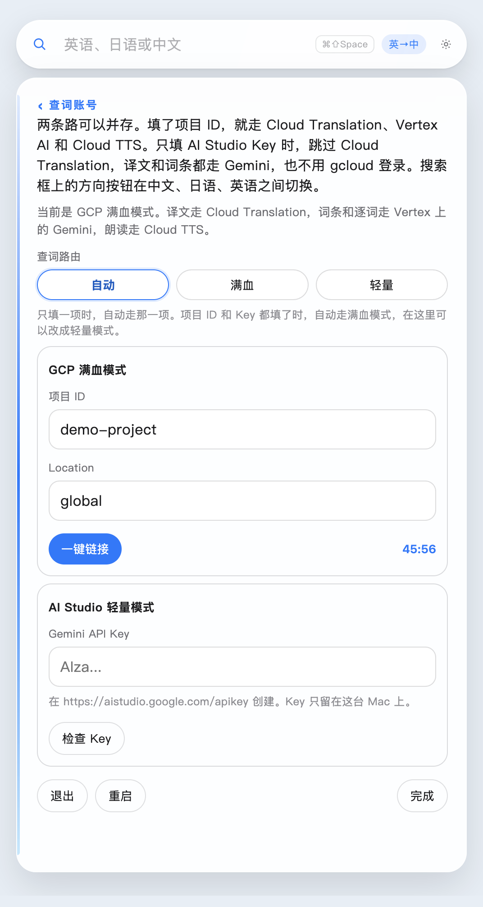

# 浮词 (Fuci)

> **中文** — 查一个词，不该离开正在读的这一页。**[快速上手 ↓](#保姆级上手教程)** · **[macOS 下载 (.dmg)](https://github.com/jayson-sheyue/fuci/releases/download/v1.4.0/fuci-1.4.0-arm64.dmg)** · **[Windows 下载 (.zip)](https://github.com/jayson-sheyue/fuci/releases/download/v1.4.0/fuci-1.4.0-win-x64.zip)**
>
> **English** — One word should not make you leave the page. **[Read in English →](README.en.md)**
>
> **日本語** — 一つの単語のために、読んでいるページを離れたくない。**[日本語で読む →](README.ja.md)**

读外文资料、论文或网页时，读到一半要查一个生词，一旦切去浏览器或词典窗口，回来时往往已经找不到刚才读到的那一行。

**浮词**是一个常驻在桌面最上层的轻量悬浮词典与翻译工具（支持 **macOS** 与 **Windows**）。它平时只是一条半透明搜索框或一颗桌面悬浮球，按 `⌘⇧Space`（Windows 为 `Ctrl+Shift+Space`）随时呼出，查完按 `Esc` 收起，视线始终停留在你正在读的那一页上。


---

## 为什么用浮词？

- **单词与句子自动分流，各有最合适的版式**
  - **查单词**：展开成结构化词典卡片——提供精准译文、音标/假名/拼音、**词形变化（比较级、动词时态、日语活用形）**、词性、双语+母语释义、双语例句与发音朗读。
  - **查句子**：不铺成冗长词条，只给**整句译文、整句读音（音标/假名/拼音）以及逐词释义拆解**，长句结构一目了然。
- **中 · 日 · 英三语互译，界面语言与翻译方向彼此独立**
  - 支持 `英↔中`、`日↔中`、`英↔日` 六个方向一键循环切换；日语汉字自带振假名（Ruby 注音）；中文译文支持**简体 / 繁体**随时切换。
- **两种接入模式自由选择，零门槛或满血体验兼顾**
  - **AI Studio 轻量模式（推荐新手，1 分钟即用）**：只需在 [Google AI Studio](https://aistudio.google.com/apikey) 免费创建一个 `Gemini API Key` 填入即可。**无需开通 GCP 项目、无需绑定信用卡结算、无需安装 `gcloud`，也没有每小时重新登录的烦恼。**
  - **GCP 满血模式（进阶完整体验）**：结合 `Cloud Translation API`（极速译文）、`Vertex AI Gemini`（深度词条与逐词解析）与 `Cloud Text-to-Speech`（自然语音朗读）。两种凭证可在设置里并存，顶部一键切换路由。
- **本机极速缓存，隐私安全**
  - 查过的完整单词和句子会自动记在这台 Mac 上（保留最近约 400 条）。同一页里再遇到同一个词，直接秒开，不用再等网络请求。所有项目 ID、API Key、登录令牌与查词缓存**仅保存在你的 Mac 本机**。

---

## 看一眼就知道它做什么

平时只有一条轻量搜索框，挡不住正在读的内容。


查**单词**会展开成一张完整词典卡片：译文、音标、词形变化（原级 / 比较级 / 最高级、动词时态等）、词性、母语释义、双语例句，还能点小喇叭分别听词头、变体和例句的读音。


查**句子**不铺成词条，只留整句译文、整句音标或拼音，以及句中每个词的读音与释义。


查**日语词**也一样。方向按钮切到「日→中」，卡片上就是振假名注音、活用形（辞書形 / ます形 / て形）和中文译文。


双击搜索框左侧的放大镜，它会收成一颗半透明小球，安静停在桌面上。双击小球再展开。


设置页分层清晰：最上面一键切换界面语言（`中文` / `日本語` / `English`），按钮和菜单立即换成对应语言；下方分设**「查词账号」「模型」「外观」**三个子页面。


在**「查词账号」**页里，`GCP 满血模式` 与 `AI Studio 轻量模式` 可以同时保存，并通过顶部的**「查词路由（自动 / 满血 / 轻量）」**随时切换。



界面语言与翻译方向互不干扰。把界面换成英语后，卡片上的「单词」「复制」会变成 `Word`、`Copy`，而译文本身仍按搜索框上的方向（如 `英→中`）输出中文。


外观页提供七种主题色：**晴空、青竹、朱砂、藤紫、琥珀、海棠、夜色**。点一下，搜索框、结果白板和悬浮球一起换色。不透明度拉杆同时作用于搜索框和结果板（默认 88%）。下面是「夜色」主题、64% 不透明度的效果：


---

## 保姆级上手教程

### 第一步：下载与安装

在 [GitHub Releases 发布页](https://github.com/jayson-sheyue/fuci/releases/tag/v1.4.0) 选择对应系统的最新安装包：

#### 🍎 macOS（Apple 芯片 M1 / M2 / M3 / M4，`arm64`）
1. **[点击下载 fuci-1.4.0-arm64.dmg](https://github.com/jayson-sheyue/fuci/releases/download/v1.4.0/fuci-1.4.0-arm64.dmg)**
2. 双击打开下载好的 `.dmg` 文件，将 **「浮词」** 拖进 **「应用程序（Applications）」** 文件夹。
3. **首次打开必看（解决 macOS 未公证弹窗）**：
   从浏览器下载的开源安装包没有苹果商业公证。第一次打开如果弹出 `“浮词” Not Opened（未打开“浮词”）`，请先点 **Done（完成）**（**切勿**点 Move to Trash / 移到废纸篓），然后任选以下一种方式解除限制：
   - **方式 A（最快，终端两行命令）**：打开 Mac 自带的「终端（Terminal）」，复制粘贴以下两行命令并回车：
     ```bash
     xattr -dr com.apple.quarantine /Applications/浮词.app
     open /Applications/浮词.app
     ```
   - **方式 B（系统设置点选）**：点 Done 之后，打开 Mac「系统设置 → 隐私与安全性」，滑到下方「安全性」一栏，点击 **「仍要打开（Open Anyway）」**。

#### 🪟 Windows（Windows 10 / 11 64 位，`x64` 免安装绿色版）
1. **[点击下载 fuci-1.4.0-win-x64.zip](https://github.com/jayson-sheyue/fuci/releases/download/v1.4.0/fuci-1.4.0-win-x64.zip)**
2. 将压缩包完整解压到任意目录（如 `D:\Apps\Fuci-win32-x64`）。
3. 双击目录中的 **`Fuci.exe`** 即可直接启动（若弹出 Windows SmartScreen 提示，点击「更多信息 → 仍要运行」即可；建议搭配下方的 **AI Studio 轻量模式** 使用，开箱即用）。

---

### 第二步：配置查词账号（两种模式任选其一）

浮词本身不包含任何内置账号或密钥。你可以根据自己的情况，在 **AI Studio 轻量模式** 和 **GCP 满血模式** 中任选一条路（也可以两条都填，在设置里随时切换）：

| 对比维度 | 路线 1：AI Studio 轻量模式（推荐新手） | 路线 2：GCP 满血模式（进阶完整体验） |
| :--- | :--- | :--- |
| **配置耗时** | **约 1 分钟** | 约 5 分钟 |
| **前置要求** | 仅需普通 Google 账号 | 需已开通结算（Billing）的 Google Cloud 项目 |
| **登录方式** | 粘贴一次 `API Key` 即可，**长期有效** | 点击「一键链接」浏览器授权，令牌每次有效约 **1 小时** |
| **查词与查句能力** | 完整支持（译文、词条、逐词拆解全部走 Gemini） | 完整支持（译文优先走 Cloud Translation，词条走 Vertex AI Gemini） |
| **语音朗读（小喇叭）** | 支持（通过 AI Studio Gemini TTS 朗读） | 支持（通过 Cloud Text-to-Speech 朗读） |

#### 路线 1：1 分钟极速上手 —— AI Studio 轻量模式（无需 GCP 项目）

如果你不想折腾 Google Cloud 项目和结算绑卡，用这条路 **1 分钟**就能开始查词：

1. 打开浏览器访问 **[Google AI Studio — API Keys](https://aistudio.google.com/apikey)** 并登录你的 Google 账号。
2. 点击页面上的 **「Create API key」**，复制生成的一串以 `AIza...` 开头的密钥。
3. 打开 **浮词**，点击搜索框最右侧的 **齿轮图标 `⚙`** 进入设置，再点击 **「查词账号」**。
4. 滑到下方的 **「AI Studio 轻量模式」** 区域，把复制好的密钥粘贴进 **「Gemini API Key」** 输入框：
   - 如果上方没有填写 GCP 项目 ID，顶部的「查词路由」保持默认的 **「自动」** 即可。
   - 如果你同时也填了 GCP 项目 ID，可以把「查词路由」点选为 **「轻量」**。
5. 点击 **「检查 Key」** 按钮验证连通性，然后点击右下角 **「完成」**。现在在搜索框输入任意单词或句子回车，即可直接查词！

#### 路线 2：完整体验 —— GCP 满血模式（极速翻译 + 语音朗读）

如果你已经有开通结算的 Google Cloud 项目，或者希望使用小喇叭语音朗读，推荐配置满血模式：

1. **准备 GCP 项目**
   登录 [Google Cloud Console](https://console.cloud.google.com/)，创建一个项目（或选择已有项目），确保该项目已关联有效的结算账户（Billing enabled），并记下它的 **项目 ID（Project ID）**（形如 `my-project-123`，注意不是项目名称或纯数字编号）。
2. **在项目中启用 3 个 API**
   在 Google Cloud 控制台顶部的搜索栏中，依次搜索并点击 **「启用（Enable）」** 以下服务：
   - **Cloud Translation API**：负责单词与句子的快速译文（若暂未启用，句子会先由 Gemini 翻译并在底部注明，启用后自动切回翻译接口）。
   - **Vertex AI API**：负责生成词典卡片的音标/假名/拼音、词形变化、词性释义与例句（默认模型 `gemini-3.8-flash`，区域 `global`）。
   - **Cloud Text-to-Speech API**：仅在点击小喇叭朗读时调用（不启用也不影响查词）。
   > **终端快捷命令（可选）**：如果你电脑上装有 `gcloud`，也可以直接在终端执行一行命令开启全部 3 个 API：
   > ```bash
   > gcloud services enable translate.googleapis.com aiplatform.googleapis.com texttospeech.googleapis.com --project=你的项目ID
   > ```
3. **确认账号 IAM 权限**
   - 如果你登录的就是该项目的创建者（`Owner`），默认已具备全部权限，直接跳到第 4 步。
   - 如果是团队成员账号，请在 [IAM 页面](https://console.cloud.google.com/iam-admin/iam) 为用来登录的 Google 账号授予以下角色（若未授予 `Cloud Translation API User`，整句翻译会自动回退至 Gemini）：
     - **Agent Platform User**（原 **Vertex AI User**，`roles/aiplatform.user`）
     - **Cloud Translation API User**（`roles/cloudtranslate.user`，推荐授予）
4. **在浮词中填写并「一键链接」**
   - 打开 **浮词** → 点击齿轮 `⚙` → 进入 **「查词账号」**。
   - 在 **「GCP 满血模式」** 下填入你的 **项目 ID**，`Location` 保持默认的 `global`。
   - 点击蓝色的 **「一键链接」** 按钮：
     - 如果这台电脑上还没有可用的 `gcloud`，浮词会自动为你下载登录组件到本机（约 80MB，仅首次需要）。
     - 随后会自动打开浏览器完成 Google 账号登录授权，并获取约 **1 小时**有效的访问令牌。
     - 按钮右侧会显示实时倒计时（如 `45:56`）。倒计时结束或提示令牌失效时，再点一次「一键链接」即可续期。

---

### 第三步：日常操作与快捷键一览

| 操作 | 方法 / 快捷键 |
| :--- | :--- |
| **呼出 / 聚焦搜索框** | 按 `⌘⇧Space` / Windows `Ctrl+Shift+Space`（若被占用则自动改用 `⌘⇧D` / `Ctrl+Shift+D`） |
| **开始查词 / 查句** | 输入单词或句子后按 `Enter` 回车 |
| **切换翻译方向** | 点击搜索框右侧的方向按钮，按 `英→中`、`英→日`、`日→中`、`日→英`、`中→英`、`中→日` 顺序循环 |
| **收起结果板 / 收成悬浮球** | 按一次 `Esc` 收起下方结果白板；再按一次 `Esc`（或双击左侧放大镜）收成桌面悬浮球 |
| **从悬浮球展开** | 双击桌面上的悬浮球，或直接按 `⌘⇧Space` |
| **拖动窗口位置** | 按住搜索框左侧的放大镜图标拖动，或在悬浮球状态下按住小球拖动 |
| **切换简繁体中文** | 打开「设置 → 外观 → 中文用字」，在「简体中文 / 繁体中文」之间切换，当前查询会自动按新字体重查 |
| **更换查词 / 朗读模型** | 打开「设置 → 模型」，可自定义查词模型（默认 `gemini-3.8-flash`）与朗读模型（默认 `gemini-3.1-flash-tts-preview`） |
| **检查并一键更新版本** | 当齿轮或悬浮球右上角出现**小红点**时，代表 GitHub `main` 有可快进的新版本；打开「设置」点击顶部 **「更新」** 即可无损升级，本机设置、登录状态和缓存全部保留 |

---

## 从源码运行与打包（开发者）

如果你希望直接从源码运行或自行打包：

```bash
# 安装依赖
npm install

# 开发模式启动
npm start

# 重新打包 macOS（会同步更新桌面上的 浮词.app、dist/浮词.app 并生成 dist/*.dmg）
npm run pack

# 打包 Windows 64 位免安装版（生成 dist/*-win-x64.zip）
npm run pack:win
```

> **排障提示**：如果执行 `npm install` 或 `npm start` 时提示 Electron 没有安装成功，通常是公司网络证书拦截了 Node 的二进制下载。可改用系统自带的 `curl` 下载对应版本的 `electron-v版本号-darwin-arm64.zip`，解压到 `node_modules/electron/dist`，并让 `node_modules/electron/path.txt` 的内容为 `Electron.app/Contents/MacOS/Electron`。
